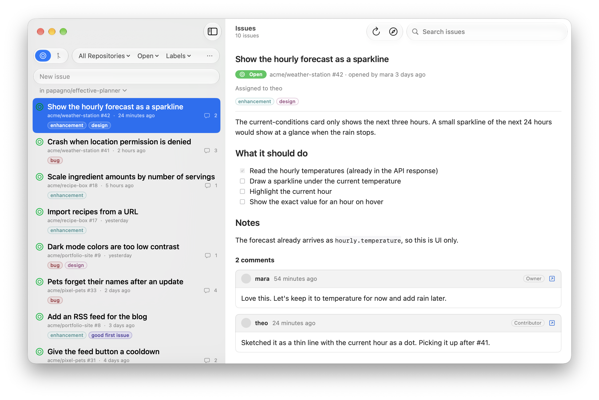
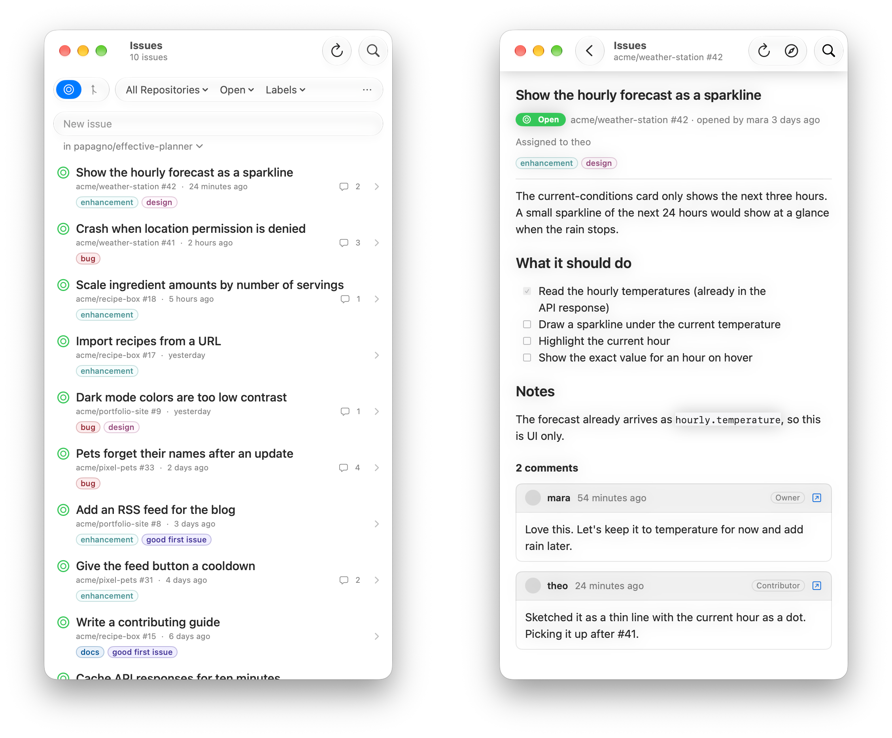

# Punchlist

*Your repos' to-dos, beside your code.*

Punchlist is a small macOS companion for when you're coding: it shows the open issues across your GitHub repositories as one list you can keep next to your editor, lets you jot down a new one in a second, and gives you a quick look at pull requests when you need it. It has no GitHub code of its own: everything goes through the [`gh` CLI](https://cli.github.com) you already have installed and signed in, so it never sees or stores a token.

<picture>
  <source media="(prefers-color-scheme: dark)" srcset="docs/screenshots/main-dark.png">
  
</picture>

## Features

- One list of the open issues or pull requests across every repository you own, optionally including your organizations.
- Filters for repository, status (open, closed, merged, all) and labels, plus search by title, repository, number or author.
- Issue and pull request detail with GitHub-style Markdown and the conversation's comments.
- Create an issue from the first row of the list: type a title, pick the repository, press Return.
- A native macOS 27 layout: a resizable glass sidebar beside the detail. Below 640 points wide, the window switches to a single list, and the detail slides in over it:

<picture>
  <source media="(prefers-color-scheme: dark)" srcset="docs/screenshots/compact-dark.png">
  
</picture>

## Install

```bash
brew install --cask papagno/tap/punchlist
```

Punchlist needs macOS 27. Homebrew installs the [GitHub CLI](https://cli.github.com) with it; sign in to GitHub once:

```bash
gh auth login
```

Punchlist updates itself: it offers new versions as they come out, or choose **Punchlist > Check for Updates…**. Updates come through [Sparkle](https://sparkle-project.org).

## Build from source

You'll need Xcode 27 or later (for the Swift 6.4 toolchain and `actool`, which compiles the app icon) and the GitHub CLI, signed in.

```bash
./bundle.sh
open build/Punchlist.app
```

`bundle.sh` builds a release binary with Swift Package Manager, compiles the Icon Composer icon in `Resources/AppIcon.icon`, and wraps both, with Sparkle's framework, into an ad-hoc signed app bundle in `build/`.

### Demo mode

Launch with `--demo` to show made-up repositories, issues and comments instead of your own; it never calls `gh`. The screenshots above were taken this way. Add `--demo-window-size 440x820` to open at a given size, e.g. for the narrow layout:

```bash
open -n build/Punchlist.app --args --demo --demo-window-size 440x820
```

## Keyboard shortcuts

| Shortcut | Action |
| --- | --- |
| ⌘N | New issue |
| ⌘F | Search |
| ⌘1 / ⌘2 | Show issues / pull requests |
| ⌘R | Refresh |
| ⌘[ | Back to the list (narrow windows) |
| ⌃⌘S | Show or hide the sidebar |

Double-click an item to open it in your browser; right-click for more actions.

## How it works

The app runs `gh search issues` / `gh search prs` with `--owner` for your account (and your organizations, if included), so results are capped at GitHub search's 1,000 items per query and archived repositories are left out. Comments come from `gh api`, and new issues are created with `gh issue create`.

Markdown is rendered with [MarkdownUI](https://github.com/gonzalezreal/swift-markdown-ui).

## Releasing

```bash
./release.sh 0.2.0
```

`release.sh` builds the app with that version, signs it with a Developer ID certificate, has Apple notarize it, and publishes it as a GitHub release. It then updates the cask in [papagno/homebrew-tap](https://github.com/papagno/homebrew-tap). It only releases a clean `main` that matches GitHub, and expects the notarization credentials in a keychain profile (`apps-notary` by default, or set `NOTARY_PROFILE`).

The release also carries an `appcast.xml`, the feed installed copies check for updates. The app's `SUFeedURL` points at the latest release's copy, and each update is signed with an EdDSA key whose public half is `SUPublicEDKey` in `bundle.sh`. The private key lives in the login keychain; keep a backup, since without it installed copies can't verify new updates. To export it, or import it on another Mac (after `swift package resolve`):

```bash
.build/artifacts/sparkle/Sparkle/bin/generate_keys -x sparkle_private_key.txt
.build/artifacts/sparkle/Sparkle/bin/generate_keys -f sparkle_private_key.txt
```

## License

Copyright © 2026 Francesco Papagno

This program is free software: you can redistribute it and/or modify it under the terms of the GNU General Public License as published by the Free Software Foundation, either version 3 of the License, or (at your option) any later version. It is distributed in the hope that it will be useful, but without any warranty; see the [GNU General Public License](LICENSE) for details.
